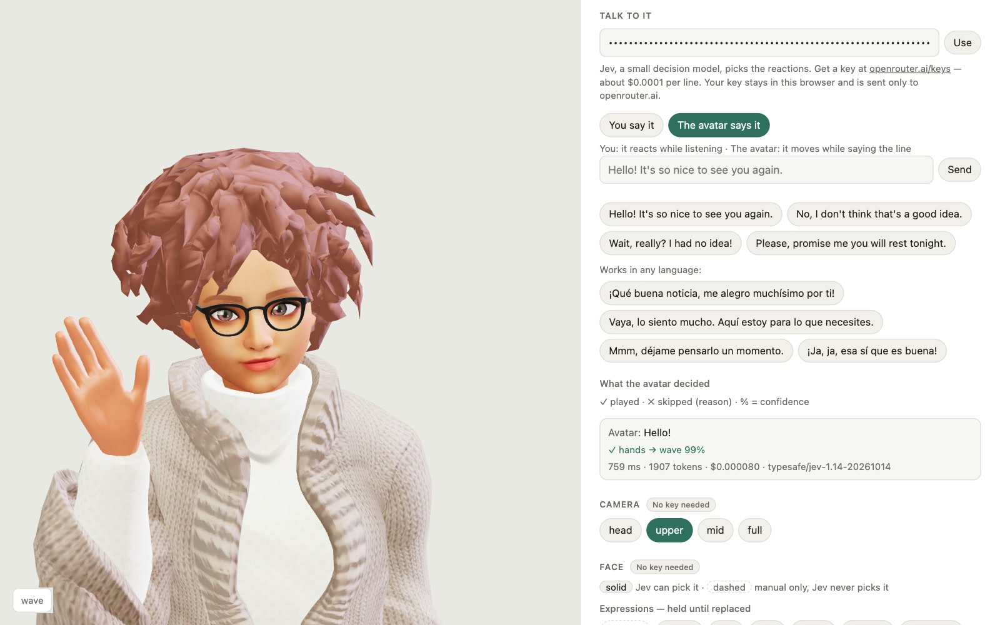

# motion-engine

Expressive face and body for [TalkingHead](https://github.com/met4citizen/TalkingHead) avatars, decided by a classifier that reads the transcript — not by tags in the LLM's output.

**[Live demo](https://lhupyn.github.io/motion-engine/)** — bring your own OpenRouter key.



- **The main LLM just talks.** No emoji, no `[happy]` markers, no extra rules in its prompt.
- **Jev decides.** Each sentence of the transcript goes to [Jev](https://typesafe.ai), TypeSafe's decision model, which answers typed questions (which expression, which head movement, which hand gesture) with a confidence.
- **A director filters.** Confidence thresholds, cooldowns and a few rules decide what actually plays.
- **FACS-grounded faces.** Expressions are Action Unit recipes resolved to ARKit blendshapes, layered so lip-sync keeps working.
- **Two body channels.** Head movements and hand gestures play at the same time, with optional bone oscillation overlays.

## Contents

- [Why it exists](#why-it-exists) · [How it works](#how-it-works) · [Speaker turns](#speaker-turns) · [Languages](#languages)
- [Quick start](#quick-start) · [Integration recipes](#integration-recipes) · [Providers and keys](#providers-and-keys)
- [Roadmap](#roadmap) · [Licenses and credits](#licenses-and-credits)
- Appendices: [A. Configuration](#appendix-a-configuration) · [B. Catalogs](#appendix-b-catalogs) · [C. Classifiers](#appendix-c-classifiers) · [D. FACS grounding and sources](#appendix-d-facs-grounding-and-sources) · [E. Development](#appendix-e-development)

## Why it exists

The usual way to make an LLM-driven avatar expressive is to ask the LLM to tag its own output: emoji, `::markers::`, `[happy]`. That has costs:

- **Tokens and prompt complexity.** Every turn carries the tag vocabulary and the rules for using it.
- **It leaks in production.** Models coin marker words that aren't in the vocabulary, leak reasoning into them, and the TTS reads them aloud.
- **It mixes two jobs.** Choosing a good answer and choosing a good face are different problems, and the second one competes with the first for the model's attention.

motion-engine moves that job to a second, specialized model. Jev reads the transcript and answers multiple-choice questions with a confidence. It doesn't write text, so nothing it returns can end up spoken, and an answer outside the menu is simply ignored. The main LLM's prompt stays untouched.

Measured in the demo with `typesafe/jev-1.14`: about **0.4–0.75 s** and **~$0.00008 per sentence** (~2,000 input tokens, one call per sentence).

## How it works

```
 transcript fragments ── feed(text, { speaker, final })
        ▼
   Segmenter      sentences; a repeated final turn is deduped; filler dropped
        ▼  one call per sentence
   Classifier     Jev by default, or your own: expression? head? hands?
        ▼         (+ "is this intelligible?" for the person's lines)
   Director       thresholds · cooldowns · one gesture per channel · relax to neutral
     ▼      ▼
   Face    Body   FACS compositor │ head + hands channels
     └──┬───┘
        ▼
   Adapter        the only module that touches TalkingHead
```

| Layer | File | What it does |
| --- | --- | --- |
| Segmenter | `src/segmenter.js` | Buffers streamed fragments into sentences (`。！？` close one too). A final fragment that repeats the turn only adds its unheard part. Drops segments with fewer than two letters or only filler (`"mm"`, `"uh, um"`); keeps `"No."`, `"Sí."`, `"Oh!"`. Releases an unfinished sentence after `pause` (800 ms). |
| Classifier | `src/systemone.js` | One request per sentence: the line, its speaker and the previous line, plus three `choice` questions built from the catalogs. See [Appendix C](#appendix-c-classifiers). |
| Director | `src/director.js` | Applies the rules below and reports every choice, applied or not, with the reason. |
| Face | `src/face.js` | Resolves AU recipes to ARKit blendshapes; cross-fades held *moods*, plays one-shot *beats*. Writes to the mood baseline so lip-sync visemes still play; gaze and blink go through TalkingHead's system slot so they outrank its idle eye animation. |
| Body | `src/body.js` | **head** (nod, shake, tilt, bow… — plain animations) and **hands** (open palms, hand on heart, wave… — arm poses through TalkingHead's gesture system) play together. One gesture per channel; a new one interrupts the current one on its channel. |
| Adapter | `src/adapter.js` | The only module that touches the TalkingHead instance; each member is labeled public / appendix / internal. `test/adapter.test.js` checks every member against TalkingHead's real source, so an upgrade that renames something fails the test instead of the avatar. Verified against TalkingHead 1.7. |

**Director rules** — each skipped choice carries its reason in `onDecision`:

- Below the confidence threshold for its channel (`low confidence`).
- A held expression that's already showing isn't restarted (`already showing`).
- A gesture channel that's still moving isn't interrupted (`already moving`); each channel has a `cooldown`.
- A line from the person judged unintelligible gets no reaction (`unclear transcript`).
- A choice that isn't in the catalog is ignored (`not in catalog`).
- An older line's answer that arrives after a newer one is dropped (`superseded by a newer line`).
- The face relaxes to `neutral` some time after the last decision (`relaxAfter`), never while the avatar is mid-line.

## Speaker turns

```js
engine.feed(text, { speaker: 'avatar' | 'user', final });
```

The same text needs a different reaction depending on who says it. *"My grandma passed away last week"* said by the avatar calls for a sad face; said by the person, the listening avatar reacts like an empathetic friend — concern or tenderness, not a copy of the person's emotion. The classifier gets different instructions for each speaker.

| | `speaker: 'avatar'` | `speaker: 'user'` |
| --- | --- | --- |
| Drives | The avatar's face and body while it speaks | A listening reaction |
| Extra check | — | "Is the transcript intelligible?" — garbled text gets no reaction |
| Skipped | — | While the avatar is speaking: the reaction would come too late |

- Avatar lines are the main input. The person's lines are optional — **if you don't feed them, nothing is called and nothing is billed.** No `feed()`, no requests.
- `final: true` marks the last fragment of a turn. It may repeat the whole turn, or be empty (`feed('', { final: true })` just ends it). Not every provider sends one, so 3 s without avatar fragments also ends the avatar's turn.
- `engine.interrupt()` handles barge-in on the avatar's side only. It aborts the avatar's in-flight calls and drops its buffered text. If the avatar was speaking, it also stops its gestures and ignores the rest of the cut-off turn — late fragments and the final transcript some providers still send — until that final, 3 s of silence, or the person's next final line. Reactions to the person and listening gestures keep going, and interrupting a quiet avatar cuts nothing, so it's safe to call whenever the person starts talking.

## Languages

Jev reads the line in whatever language it's in; the catalog descriptions stay in English. The demo has been checked with Spanish and English lines. Other languages should work the same way but haven't been tested.

## Quick start

No build step: plain ES modules, with the catalogs loaded as JSON modules (`import … with { type: 'json' }`). Like TalkingHead, it can come straight from a CDN through an import map:

```html
<script type="importmap">
{ "imports": {
  "three": "https://cdn.jsdelivr.net/npm/three@0.180.0/build/three.module.js/+esm",
  "three/addons/": "https://cdn.jsdelivr.net/npm/three@0.180.0/examples/jsm/",
  "talkinghead": "https://cdn.jsdelivr.net/gh/met4citizen/TalkingHead@1.7/modules/talkinghead.mjs",
  "motion-engine": "https://cdn.jsdelivr.net/gh/lhupyn/motion-engine@1.0.0/src/index.js"
} }
</script>
```

`@1.0.0` pins this release; use the tag you want. JSON import attributes need Chrome/Edge 123+, Safari 17.2+, Firefox 138+ or Node 22+. Or install from GitHub (not on npm yet) and use any bundler: `npm i github:lhupyn/motion-engine`. TalkingHead is not a dependency — bring your own (verified against 1.7).

```js
import { TalkingHead } from 'talkinghead';
import { MotionEngine, systemOne } from 'motion-engine';

const head = new TalkingHead(document.getElementById('avatar'), { /* ... */ });
await head.showAvatar({ url: './avatar.glb', body: 'F' });

const engine = new MotionEngine(head, { classify: systemOne({ apiKey: userKey }) }); // Jev via OpenRouter
engine.onDecision = (d) => console.log(d.text, d.actions, d.ms, d.usage);
engine.feed('Hello! It is so nice to see you again.', { speaker: 'avatar', final: true });
```

Without `classify`, `feed()` does nothing. Create the engine after `showAvatar()`. It hooks into TalkingHead's frame loop (`opt.update`) by itself, chaining any callback you already set.

**`onDecision(d)`** is called once per sentence:

| Field | Meaning |
| --- | --- |
| `speaker`, `text` | The line |
| `actions` | `[{ channel: 'face' \| 'head' \| 'hands', name, confidence, applied, reason? }]` |
| `answers` | The classifier's raw answers |
| `ms`, `model`, `usage` | Latency, model id, and `usage` as returned by the provider (e.g. `input_tokens`, `cost`) |
| `skipped` | Why the line wasn't sent, or why its answer was dropped |
| `error` | The request failed |

**Direct control** — the face and body without a classifier:

```js
engine.face.play('happy');        // a mood: held, cross-fades from the previous one
engine.face.play('wink');         // a beat: plays once on top
engine.face.play('neutral');      // fade the held expression out
engine.body.play('nod');          // head channel; resolves true when done
engine.body.play('thumbs_up');    // hands channel; plays together with the nod
engine.body.stop();               // both channels, or stop('head') / stop('hands')
```

`engine.face.names`, `engine.body.names` and `engine.body.gestures` list what's available.

**Lifecycle**

| Method | What it does |
| --- | --- |
| `feed(text, { speaker, final })` | Feed transcript text, see [Speaker turns](#speaker-turns). |
| `interrupt()` | Barge-in: drop the avatar's pending text and calls, and ignore the rest of the cut-off turn. |
| `useClassifier(classify)` | Set or replace the classifier at any time, e.g. `useClassifier(systemOne({ apiKey }))` (the demo does this when the visitor pastes a key). |
| `dispose()` | Unhook from TalkingHead's render loop, abort calls, clear timers, stop the body and reset the face. `feed()` does nothing afterwards. |

## Integration recipes

motion-engine has no SDK code. Feed it whatever transcript your stack produces.

**Gemini Live** — enable `outputAudioTranscription` and `inputAudioTranscription` in the session config:

```js
onmessage: (msg) => {
  const sc = msg.serverContent;
  const out = sc?.outputTranscription, inp = sc?.inputTranscription;
  if (out) engine.feed(out.text ?? '', { speaker: 'avatar', final: !!out.finished });
  if (inp) engine.feed(inp.text ?? '', { speaker: 'user', final: !!inp.finished });
  if (sc?.interrupted) engine.interrupt();
}
```

**OpenAI Realtime** — with input audio transcription enabled. Calling `interrupt()` on every `speech_started` is safe: it doesn't cut a listening reaction.

```js
switch (event.type) {
  case 'response.output_audio_transcript.delta': engine.feed(event.delta, { speaker: 'avatar' }); break;
  case 'response.output_audio_transcript.done': engine.feed(event.transcript, { speaker: 'avatar', final: true }); break;
  case 'conversation.item.input_audio_transcription.completed': engine.feed(event.transcript, { speaker: 'user', final: true }); break;
  case 'input_audio_buffer.speech_started': engine.interrupt(); break;
}
```

**Plain text chat:**

```js
engine.feed(userMessage, { speaker: 'user', final: true });
for await (const chunk of llmStream) engine.feed(chunk, { speaker: 'avatar' });
engine.feed(fullReply, { speaker: 'avatar', final: true });
```

## Providers and keys

| Option | Where it runs | Notes |
| --- | --- | --- |
| `systemOne({ apiKey })` (provider `'openrouter'`, the default) | Browser or server | OpenRouter accepts requests from any origin, so a public page can use the **visitor's own key**. |
| `systemOne({ apiKey, provider: 'typesafe' })` | Server only | TypeSafe's API only accepts browser requests from its own console. |
| `systemOne({ url })` | Anywhere | Your own proxy (which holds the key) or a self-hosted decision model. |
| Your own function | Anywhere | Anything with the classifier contract. |

Options, other decision models and the contract: [Appendix C](#appendix-c-classifiers).

**Never ship a key in a bundle.** Bundlers inline build-time env vars (Vite inlines every `VITE_*`) into the public JavaScript. Either let the visitor bring their own key, or put a proxy in front. The demo stores the visitor's key in `localStorage` and sends it only to openrouter.ai.

## Roadmap

Planned, not built yet:

- **Blend the top two expressions** by the probabilities Jev already returns (no extra tokens).
- **An intensity question** — one score question, so expressions and head movements can play softer or stronger.
- **Torso posture channel** — a third body channel for conversational posture: leaning in (interest), leaning back (surprise, doubt), shrinking (shyness). One more question per call, visible in the demo's framing.
- **Pose authoring tool** — an FK solver that fits the catalog's poses to a new avatar.
- **Camera-based listening** (FaceMirror) as an optional plugin.

## Licenses and credits

**Code:** [MIT](LICENSE), Copyright (c) 2026 lhupyn.

**Demo avatar — not covered by the MIT license.** `demo/public/female_1.glb` was created with [Ready Player Me](https://readyplayer.me). Ready Player Me's terms license avatars made with its creator under [CC BY-NC-SA 4.0](https://creativecommons.org/licenses/by-nc-sa/4.0/): attribution, non-commercial use only, share-alike. Ready Player Me's public service shut down on 2026-01-31. Don't use this file in commercial products; bring your own avatar.

**Credits**

- [TalkingHead](https://github.com/met4citizen/TalkingHead) by Mika Suominen — MIT. Loaded from a CDN in the demo; not bundled.
- [three.js](https://threejs.org) — MIT. Loaded from a CDN in the demo; not bundled.
- [Jev](https://typesafe.ai) by TypeSafe — the default decision model, called through its API (not bundled).
- FACS sources: [Appendix D](#appendix-d-facs-grounding-and-sources).

---

## Appendix A: Configuration

```js
new MotionEngine(head, {
  classify: systemOne({ apiKey }),
  pause: 800,
  director: { minConfidence: { hands: 0.7 }, relaxAfter: 8000 },
  face: { fade: 400 },
  body: { fadeIn: 800 },
});
```

**Engine**

| Option | Default | Description |
| --- | --- | --- |
| `classify` | `null` | The classifier, e.g. `systemOne({ apiKey })` ([Appendix C](#appendix-c-classifiers)). Without it, `feed()` does nothing. |
| `pause` | `800` | Classify an unfinished sentence after this many ms without new fragments. |
| `director`, `face`, `body` | — | Options for each layer, below. |

**`director`**

| Option | Default | Description |
| --- | --- | --- |
| `minConfidence` | `{ expression: 0.45, head: 0.5, hands: 0.55 }` | Minimum confidence per channel. Partial objects are merged with the defaults. |
| `minClarity` | `0.5` | For the person's lines: below this "intelligible" score, nothing plays. |
| `cooldown` | `{ head: 2500, hands: 4000 }` | Minimum ms between gestures on each channel. |
| `relaxAfter` | `6000` | Ms after the last decision before the face relaxes to `neutral`. |

**`face`**

| Option | Default | Description |
| --- | --- | --- |
| `facs` | built-in `facs.json` | Expression catalog, see [Appendix B](#appendix-b-catalogs). |
| `fade` | `400` | Mood cross-fade, ms. |

Beats without their own `envelope` use `{ in: 300, hold: 1500, out: 600 }` ms.

**`body`**

| Option | Default | Description |
| --- | --- | --- |
| `gestures` | built-in `gestures.json` | Gesture catalog, `{ head, hands, poses }`. |
| `fadeIn` | `800` | Arm transition into a pose, ms, unless the gesture frame sets its own. |
| `fadeOut` | `800` | Hand gesture fade-out, ms. |
| `cutFade` | `100` | Fade when a gesture is interrupted, ms. |
| `settle` | `1000` | Wait after a hand gesture fades out before the channel counts as free, ms. |

## Appendix B: Catalogs

Both catalogs are plain JSON and ship as package exports (`motion-engine/facs.json`, `motion-engine/gestures.json`), so you can start from them. Pass your own as `face: { facs }` and `body: { gestures }`:

```js
import facs from './my-facs.json' with { type: 'json' };
import gestures from './my-gestures.json' with { type: 'json' };

new MotionEngine(head, { classify: systemOne({ apiKey }), face: { facs }, body: { gestures } });
```

**Rules for both**

- **Only entries with a `description` are offered to the classifier.** Entries without one are manual-only: still playable with `face.play` / `body.play`. In the bundled catalogs that's `wave_left` and `hand_raise_left` (the classifier can't pick a side from text), the face's gaze beats (`look_left`, …), `open_mouth`, `close_eyes`, `squint` and `neutral`.
- **The description says *when* to use it**, not what it looks like: *"Warm, genuine smile: glad, pleased, friendly, good news."*
- **Keep options distinct.** Two similar options split the confidence between them, and both can end up under the threshold.
- **Validate faces still and while talking.** An expression that looks right on a silent face can fight the lip-sync visemes; keep jaw opening out of held moods.

### `facs.json`

Values below are illustrative.

```json
{
  "au_map": {
    "AU12": { "mouthSmileLeft": 1, "mouthSmileRight": 1 }
  },
  "expressions": {
    "happy": {
      "description": "Warm, genuine smile: glad, pleased, friendly, good news.",
      "facs": "EMFACS-7 happiness: AU6+AU12",
      "aus": { "AU6": 0.3, "AU12": 0.6 }
    },
    "wink": {
      "description": "A playful wink: a shared secret, a joke, flirting.",
      "kind": "beat",
      "aus": { "AU43_L": 0.7 },
      "envelope": { "in": 120, "hold": 140, "out": 220 }
    }
  }
}
```

| Field | Meaning |
| --- | --- |
| `au_map` | FACS Action Unit → ARKit blendshapes with weights. Calibrated per avatar model. |
| `expressions.<name>.description` | When to use it. Without it, the classifier never picks it. |
| `facs` | Provenance note (which AU combination, which source). Not used at runtime. |
| `kind` | `'mood'` (default) holds until replaced and cross-fades; `'beat'` plays once on top. |
| `aus` | AU → final level. A trailing `_L` / `_R` makes it one-sided (`AU12_L`). Final blendshape value = AU level × `au_map` weight, clamped to 0–1. |
| `envelope` | Beats only: `{ in, hold, out }` in ms. |

Keep an entry named `neutral`: the director relaxes to it.

### `gestures.json`

`head` and `hands` hold the gestures; `poses` holds custom arm poses the hand gestures use. Trimmed example (a real pose also sets the shoulder, hand and finger bones):

```json
{
  "head": {
    "nod": {
      "description": "A head nod: agreeing, saying yes, confirming.",
      "dt": [260, 240, 240, 320],
      "vs": { "headMove": [0], "headRotateX": [0.18, -0.03, 0.13, 0], "headRotateZ": [0] }
    }
  },
  "hands": {
    "wave": {
      "description": "A wave: hello or goodbye.",
      "dt": [100, 2400],
      "rescale": [0, 1],
      "vs": { "gesture": [["hand_wave", null, true, 500], null] },
      "overlay": {
        "bones": { "RightHand": { "freq": 14, "amp": [0, 0.2, 0.25], "phase": 0 } },
        "delay": 500,
        "duration": 2000
      }
    }
  },
  "poses": {
    "hand_wave": {
      "LeftArm.rotation": { "x": 1.394, "y": 0.048, "z": 1.016 },
      "LeftForeArm.rotation": { "x": -1.246, "y": -0.683, "z": 1.58 }
    }
  }
}
```

**Gestures.** Each `head` and `hands` entry is a TalkingHead animation template (TalkingHead's README, Appendix D): `dt` frame timings (a `[min, max]` pair counts as its midpoint), optional `rescale`, and `vs` values per frame. Head entries play as plain animations; hand entries go through TalkingHead's gesture system. Gestures are body-only by design — the face belongs to the FACS layer, and a test keeps blendshapes out of `gestures.json`.

**Hand frames.** Each frame in `vs.gesture` is `[pose, duration, mirror, transitionMs]`:

| Item | Meaning |
| --- | --- |
| `pose` | A TalkingHead built-in pose (`handup`, `index`, `ok`, `thumbup`, `thumbdown`, `side`, `shrug`, `namaste`) or one from `poses`. |
| `duration` | `null` holds the pose until the gesture ends (JSON has no `Infinity`). |
| `mirror` | `true` plays a one-hand pose with the right arm. Default `false`. |
| `transitionMs` | How long the arms take to reach the pose. Default: the body's `fadeIn` (800 ms). |

Frames fire at the `dt` boundaries, so several frames chain poses (`applause` alternates `namaste` and `clap_open`). When a new hand gesture replaces the current one, the arms go straight from pose to pose instead of dropping to the stance first.

**Poses.** Pose name → bone rotations in radians (Euler XYZ), the same format as TalkingHead's `gestureTemplates`. As in TalkingHead, one-hand poses are written for the left arm and mirrored for the right. A pose can't reuse a built-in's name (it's skipped with a warning). The bundled poses are fitted to the demo avatar's proportions; on another avatar, hands may miss their target (the chest, the chin) and the poses may need re-solving.

**Overlays.** `overlay` adds sine oscillations on top: per bone, `freq` (rad/s), `amp` `[x, y, z]` (rotation offsets in radians), `phase` (z only); plus `delay` and `duration` in ms.

## Appendix C: Classifiers

Every classifier gets the same questions and returns the same answers ([contract](#custom-classifier)), so they're interchangeable.

### `systemOne()`

```js
import { MotionEngine, systemOne } from 'motion-engine';

new MotionEngine(head, { classify: systemOne({ apiKey }) });
```

A client for the System One API. By default it asks Jev through OpenRouter. Measured cost and latency: [Why it exists](#why-it-exists).

| Option | Default | Description |
| --- | --- | --- |
| `apiKey` | — | OpenRouter or TypeSafe key. |
| `provider` | `'openrouter'` | `'openrouter'` (`https://openrouter.ai/api/v1/systemone`, works from the browser) or `'typesafe'` (`https://api.typesafe.ai/v1/systemone`, server only). |
| `model` | `'~typesafe/jev-latest'` (OpenRouter), `'jev-latest'` (TypeSafe) | Model id. |
| `url` | provider endpoint | Override the endpoint: your own proxy or a self-hosted model. |

It returns `classify(state, questions, { signal })` → `Promise<{ answers, model, usage, ms }>`. A failed request rejects with `System One <status>: <message>`, which reaches `onDecision({ error })`.

### Other decision models

Jev speaks the System One API (typed `choice` / `noul` questions in, answers with confidences out), and other decision models share it. `systemOne()` reaches any of them without code changes: by `model` on OpenRouter, or by `url` on your own server. Only Jev has been tested with motion-engine.

- **On OpenRouter:** pick a model id from its [list of decision models](https://openrouter.ai/api/v1/models?output_modalities=decisions) (JSON) and pass it: `systemOne({ apiKey, model: '<model id>' })`.
- **Self-hosted** — open models that ship a System One server (`POST /v1/systemone`); not tested by us:
  - [Kev](https://github.com/jaredpalmer/kev) — Apache-2.0, 0.8B to 27B, built on Qwen.
  - [Laya](https://github.com/NandhaKishorM/laya) — Apache-2.0, runs on CPU, multilingual.

  Point `url` at it, e.g. `systemOne({ url: 'http://localhost:8009/v1/systemone', model: '<model id>' })`. A web page can only call your server if it allows the page's origin (CORS); otherwise call it from your backend.

The default thresholds were set with Jev; another model's confidences may sit differently, so check `minConfidence` against its answers in `onDecision`.

### Custom classifier

Any function that honors this contract can replace `systemOne()`:

```js
new MotionEngine(head, { classify: async (state, questions, { signal }) => ({ answers }) });
```

**`state`** — the line to classify (`previous` is omitted on the first line):

```js
{ speaker: 'avatar' | 'user', text: 'Wait, really?', previous: { speaker: 'user', text: 'I got the job.' } }
```

**`questions`** — keyed by what the director reads back. `clear` is only asked for the person's lines.

```js
{
  expression: { type: 'choice', instructions: '…', criteria: { happy: 'Warm, genuine smile: …', /* … */ none: 'No change of expression.' } },
  head:       { type: 'choice', instructions: '…', criteria: { nod: 'A head nod: …', /* … */ none: 'No head movement.' } },
  hands:      { type: 'choice', instructions: '…', criteria: { /* … */ none: 'No hand gesture.' } },
  clear:      { type: 'noul', instructions: '…', criteria: { true: '…', false: '…' } },
}
```

`criteria` of a `choice` maps each option name to its catalog description, plus `none`. `noul` is a yes/no question.

**Return value** — `Promise<{ answers, model?, usage?, ms? }>`. The director reads:

| Key | Shape | Meaning |
| --- | --- | --- |
| `answers.expression`, `answers.head`, `answers.hands` | `{ choice, confidence }` | `choice` is one of the `criteria` keys; `'none'` or a missing key plays nothing. `confidence` is 0–1 and compared with `minConfidence`; a missing confidence counts as below it. |
| `answers.clear` | `{ noul }` | 0–1, how likely the line is intelligible. Compared with `minClarity`; if missing, the line counts as clear. |

`model`, `usage` and `ms` are passed through to `onDecision` untouched. Honor `signal`: when the engine aborts a call, reject with an `AbortError` and nothing is reported. Any other rejection is reported as `onDecision({ error })`. An answer that resolves after its call was aborted (by `interrupt()` or `dispose()`) is dropped anyway, so a classifier that ignores the signal only wastes the request.

## Appendix D: FACS grounding and sources

The seven core emotions (happiness, sadness, surprise, fear, anger, disgust, contempt) use the canonical EMFACS-7 Action Unit combinations. The rest of the ~30 expressions are documented blends of the same primitives; each records its provenance in its `facs` field.

- **EMFACS-7** — Emotional FACS (Ekman & Friesen, 1983): canonical AU combinations for the basic emotions. [paulekman.com](https://www.paulekman.com/facial-action-coding-system/)
- **ARKit ↔ FACS** — each ARKit blendshape ≈ one FACS AU. [Melinda Ozel's cheat sheet](https://melindaozel.com/arkit-to-facs-cheat-sheet/) · [clinical blendshape ↔ AU mapping](https://www.sciencedirect.com/science/article/pii/S2451958826001995) · [interactive ARKit-52 ↔ AU guide](https://arkit.miniface.org/faces)
- **AU-Blendshape** — fine-grained stylized 3D facial expression manipulation through Action Units, and why each model needs its own AU calibration. [arXiv:2507.12001](https://arxiv.org/abs/2507.12001)

## Appendix E: Development

```bash
npm install
npm run demo     # Vite dev server for demo/
npm test         # Vitest, including the adapter contract test against TalkingHead's source
npm run build    # Build the demo into dist/
```

Pushing to `main` tests, builds and publishes the demo to GitHub Pages (`.github/workflows/pages.yml`). The built demo loads three.js and TalkingHead from a CDN via its import map; during development Vite resolves them from `node_modules`, and the `talkinghead` dev dependency also feeds the contract test.
